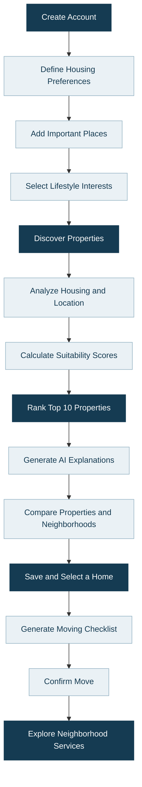
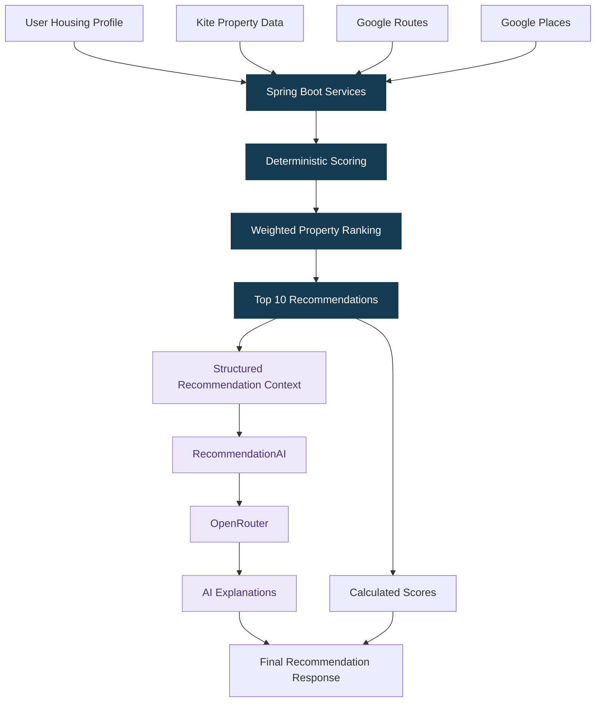
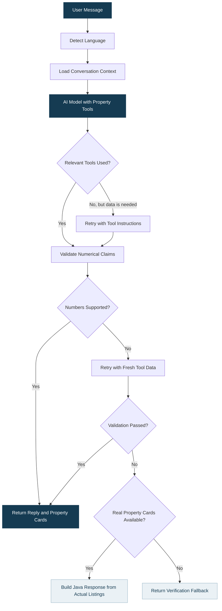
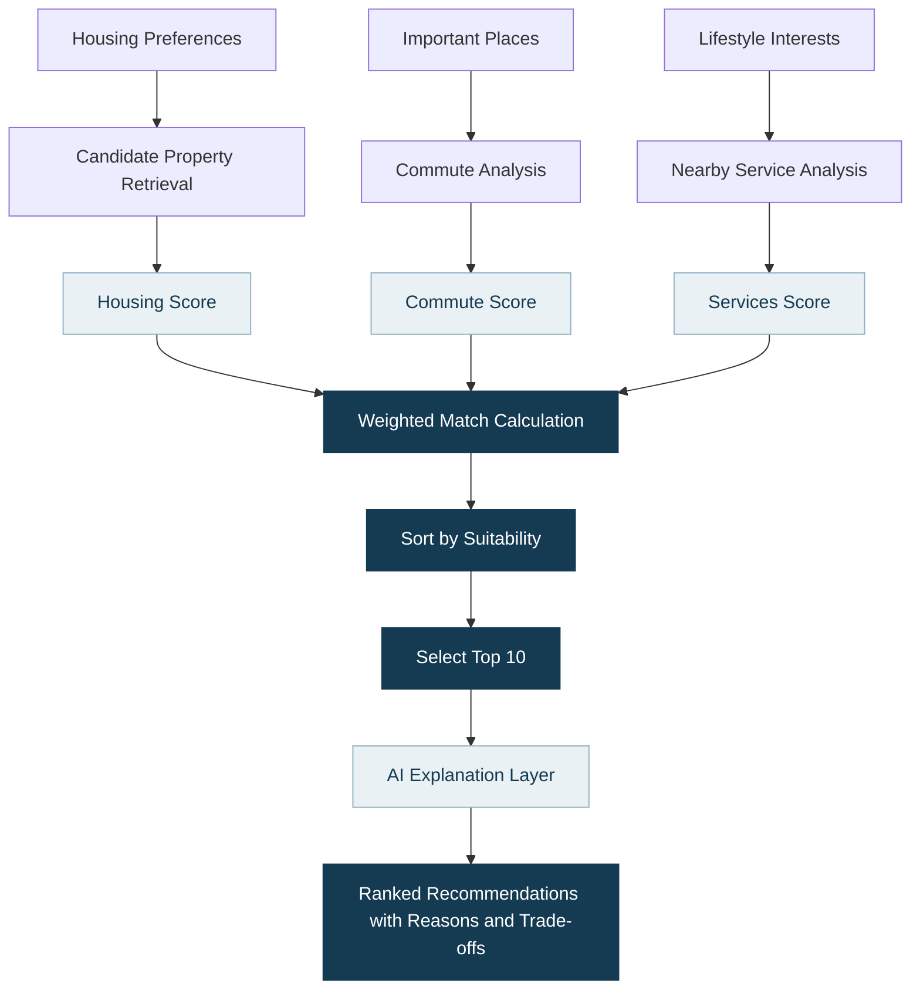
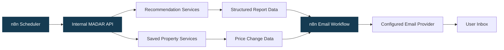
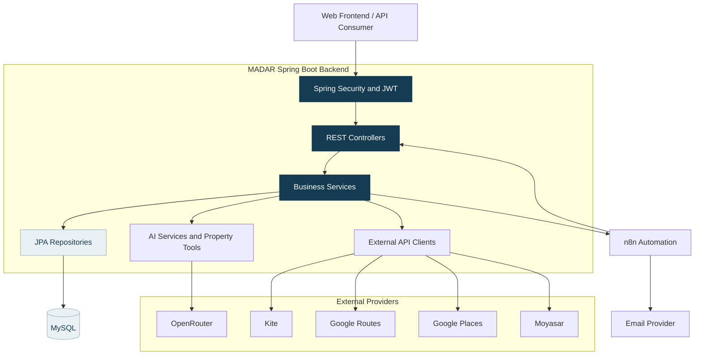
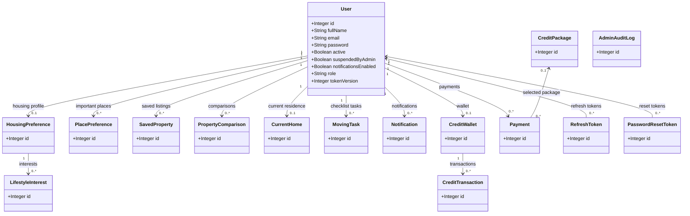
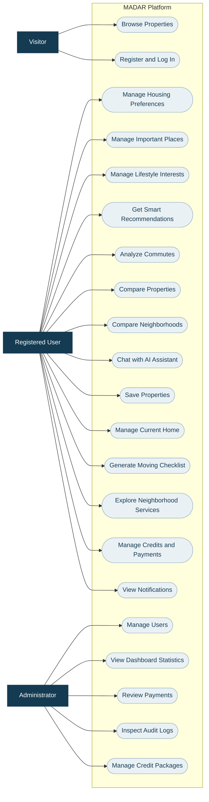

<div align="center">

<!-- Replace with the actual path to MADAR's original logo -->


# MADAR | مدار

### كل ما يهمك، أقرب لك

**Everything That Matters, Closer to You.**

### An Intelligent Housing Decision Platform for Saudi Arabia

**Find a home that fits your life — not just your search filters.**

<br>


**Personalized Housing · Explainable Recommendations · Location Intelligence · AI Assistance**

</div>

---

## Contents

- [01. About MADAR](#01-about-madar)
- [02. The Problem](#02-the-problem)
- [03. Our Solution](#03-our-solution)
- [04. How MADAR Works](#04-how-madar-works)
- [05. Core Features](#05-core-features)
- [06. AI Architecture](#06-ai-architecture)
- [07. MADAR AI Assistant](#07-madar-ai-assistant)
- [08. Recommendation Engine](#08-recommendation-engine)
- [09. Featured API Endpoints](#09-featured-api-endpoints)
- [10. n8n Automation](#10-n8n-automation)
- [11. External Integrations](#11-external-integrations)
- [12. Technology Stack](#12-technology-stack)
- [13. System Architecture](#13-system-architecture)
- [14. UML Class Diagram](#14-uml-class-diagram)
- [15. Use Case Diagram](#15-use-case-diagram)
- [16. Project Structure](#16-project-structure)
- [17. Installation & Configuration](#17-installation--configuration)
- [18. Security & Reliability](#18-security--reliability)
- [19. Engineering Highlights](#19-engineering-highlights)
- [20. Team & Acknowledgments](#20-team--acknowledgments)

---

# 01. About MADAR

**MADAR** is a Saudi intelligent housing platform designed to transform property searching into a personalized decision-making experience.

Finding a property is not necessarily the same as finding the right home.

A suitable home must accommodate more than a budget and a preferred location. It should also reflect the user's daily commute, important destinations, household requirements, lifestyle interests, and access to essential neighborhood services.

MADAR brings these considerations together.

The platform integrates Saudi real estate data, location-based services, backend scoring algorithms, and generative artificial intelligence to help users discover, evaluate, and compare housing alternatives.

Instead of simply showing available properties, MADAR helps users understand:

- Which properties best match their requirements?
- How convenient is each location for their daily routine?
- What services and facilities are available nearby?
- Why is one property recommended over another?
- What compromises should they consider before deciding?

The experience continues beyond property selection through moving preparation and neighborhood exploration.

> **MADAR's mission:** Help people make more informed housing decisions by connecting real estate choices with the realities of everyday life.

---

# 02. The Problem

## Housing decisions are more complex than property searches.

Most real estate platforms focus primarily on listing information:

- Price
- Location
- Property type
- Area
- Number of rooms

Although these details are important, they do not provide a complete picture of how well a home fits someone's lifestyle.

### Common challenges

| Challenge | Why It Matters |
|---|---|
| Fragmented information | Users switch between real estate platforms, maps, and service directories. |
| Limited personalization | Traditional filters do not fully capture individual priorities. |
| Commuting uncertainty | A seemingly suitable property may involve inconvenient daily journeys. |
| Neighborhood differences | Nearby services can significantly affect everyday convenience. |
| Difficult comparisons | Evaluating several properties manually is time-consuming. |
| Unclear recommendations | Users may not understand why one property is more suitable than another. |
| Moving preparation | Finding a home does not eliminate the complexity of preparing to move. |

### The question behind MADAR

**What if finding the right home started with understanding the person who will live in it?**

---

# 03. Our Solution

MADAR introduces a lifestyle-centered housing decision process.

The platform combines personal requirements, real estate information, geographic data, suitability calculations, and AI-generated explanations.

## From property searching to housing intelligence

| Traditional Property Search | MADAR |
|---|---|
| Search by price and location | Evaluate properties against personal requirements |
| Display property specifications | Calculate multidimensional suitability scores |
| Show a property on a map | Analyze important commutes and nearby services |
| Compare basic listing details | Compare housing suitability and practical trade-offs |
| Return filtered listings | Rank up to 10 personalized recommendations |
| Leave decisions to manual interpretation | Explain recommendations using grounded AI |
| End at property selection | Support moving preparation and neighborhood exploration |

### Our approach

MADAR is built around three connected principles:

**Personalization**

Understand what matters to each user.

**Explainability**

Show not only what is recommended, but why.

**Continuity**

Support the journey from exploring properties to settling into a neighborhood.

---

# 04. How MADAR Works



### 1. Build a housing profile

Users specify their budget, preferred location, property requirements, and household information.

### 2. Identify important destinations

Users save locations that influence their daily lives, such as workplaces, universities, or family destinations.

### 3. Define lifestyle interests

Users select the categories of places and services they value.

### 4. Discover available properties

MADAR retrieves real estate information from an external Saudi property data provider.

### 5. Evaluate suitability

Backend algorithms calculate housing, commuting, and neighborhood-service suitability.

### 6. Receive personalized recommendations

The system ranks properties and presents up to 10 recommendations with calculated scores and AI explanations.

### 7. Compare alternatives

Users examine differences between properties and neighborhoods before deciding.

### 8. Prepare for moving

MADAR creates a moving checklist with standard and AI-assisted tasks.

### 9. Explore the new neighborhood

After confirming the move, users can discover nearby services and essential facilities.

---

# 05. Core Features

## 5.1 Smart Property Discovery

MADAR retrieves real estate listings through its external property data integration.

Users can explore properties through several search and filtering capabilities.

### Available capabilities

- Search available listings
- Retrieve property details
- Filter by city and district
- Filter by listing and property type
- Search within a price range
- Search around geographic coordinates
- Find properties within a budget
- Explore properties below a budget margin
- Retrieve similar properties
- Sort property results
- Retrieve price statistics
- Retrieve listing counts

Property data is obtained from the external provider rather than maintained as a complete local property catalog.

---

## 5.2 Personalized Top 10 Recommendations

MADAR's recommendation engine evaluates properties against each user's requirements.

The backend considers housing characteristics, commuting information, and neighborhood services when the necessary data is available.

The system ranks candidate properties and returns up to 10 of the most suitable results.

### Recommendation output

| Field | Description |
|---|---|
| Rank | Recommendation position |
| Property Details | Title, city, district, price, bedrooms, and area |
| Match Score | Overall calculated suitability |
| Housing Score | Alignment with housing requirements |
| Commute Score | Convenience of important destinations |
| Services Score | Suitability of nearby services |
| AI Reason | Explanation of the recommendation |
| AI Trade-off | Potential limitation or compromise |
| Listing URL | Original property listing |

The number of returned recommendations depends on available eligible properties and successful data retrieval.

---

## 5.3 Explainable Suitability Scores

MADAR distinguishes between different dimensions of housing suitability.

### Housing Score

Evaluates how well a property's characteristics align with the user's requirements.

Relevant factors include:

- Budget
- Property type
- Listing type
- Preferred location
- Bedroom requirements
- Household suitability

### Commute Score

Evaluates commuting convenience using important destinations and available routing information.

### Services Score

Evaluates nearby services in relation to the user's selected interests.

### Overall Match Score

Combines available scoring dimensions using a weighted backend calculation.

The scoring system supports configurable weights.

**The numerical ranking is produced by backend algorithms, not invented by the language model.**

---

## 5.4 AI Recommendation Explanations

MADAR adds a natural-language explanation layer to its recommendation engine.

For each supported recommendation, AI can explain:

- Why the property is suitable
- Which requirements it satisfies
- Which characteristics make it attractive
- Which trade-offs should be considered
- How its suitability differs from other options

The explanation is generated using structured property and scoring information.

This makes recommendations easier to interpret without delegating the numerical scoring process to generative AI.

---

## 5.5 Intelligent Property Comparisons

MADAR supports property comparison through multiple workflows.

### Direct comparison

Compare two properties using their external source and listing identifiers.

### Saved-property comparison

Compare multiple properties previously saved by the user.

### Comparison management

Users can create, retrieve, update, and delete saved comparison records.

The backend includes ownership validation and duplicate-comparison prevention.

AI-generated explanations complement the structured comparison information.

---

## 5.6 Neighborhood Intelligence

MADAR helps users evaluate residential areas beyond their listing prices.

Capabilities include:

- Neighborhood suitability analysis
- Comparison between two neighborhoods
- Personalized neighborhood suggestions
- Selection of a preferred neighborhood
- Property recommendations within the selected neighborhood

The backend performs the relevant data retrieval and calculations, while AI explains supported results.

---

## 5.7 Commute Intelligence

MADAR integrates Google Routes to evaluate travel information related to users' important destinations.

Users can maintain important places and their relative importance.

This information helps the platform consider everyday mobility when evaluating potential homes.

The feature relies on routing data and backend calculations rather than generative travel-time estimates.

---

## 5.8 Lifestyle & Nearby Services

MADAR integrates Google Places to retrieve nearby service information.

Users can explore places based on location and lifestyle-related categories.

Examples include:

- Cafés
- Parks
- Fitness facilities
- Shopping destinations
- Essential neighborhood services

The backend uses available place information to support neighborhood discovery and service suitability calculations.

---

## 5.9 MADAR AI Housing Assistant

MADAR includes a contextual housing assistant that can retrieve relevant information using application tools.

It is designed to help users explore properties and understand housing-related information through natural conversation.

Unlike a basic chatbot, MADAR's assistant is connected to the application's property and user-context services.

Its architecture is explained in detail in [Section 07](#07-madar-ai-assistant).

---

## 5.10 AI-Assisted Moving Checklist

MADAR helps users prepare for moving into their selected home.

The checklist combines fixed preparation tasks with AI-generated tasks based on available property details.

### Fixed tasks

Examples include:

- Updating the national address
- Preparing utility arrangements
- Arranging internet service

### AI-assisted tasks

The AI can suggest property-specific preparation or verification tasks.

The generation process is constrained by available property information to reduce unsupported assumptions.

### Checklist management

Users can:

- Generate a checklist
- Retrieve tasks
- Mark tasks as completed or incomplete
- Reset the checklist

---

## 5.11 Current Home & Neighborhood Discovery

Users can manage their current-home information.

After confirming their move, they can explore services around the selected residence.

### Capabilities

- Set a current home
- Update current-home information
- Remove the current-home record
- Confirm moving
- Retrieve current-home status
- Explore neighborhood services
- Search nearby places
- Filter places by category
- Find essential facilities

This extends MADAR beyond property discovery into the user's post-selection experience.

---

## 5.12 Saved Properties & Price Monitoring

Users can save properties for future reference.

MADAR stores external listing references and relevant saved-property information.

The backend also supports price-change detection.

### Price-monitoring process

1. Retrieve saved property references.
2. Request current listing information.
3. Compare the current price with the stored price.
4. Update changed price information.
5. Create eligible user notifications.
6. Return structured price-change data for automation.

Price comparison is implemented through backend business logic.

---

## 5.13 Credit Wallet

MADAR includes a credit-based service access system.

### Wallet capabilities

- Retrieve credit balance
- View transaction history
- Retrieve service prices
- Purchase credit packages
- Reserve credits for supported operations
- Confirm successful reservations
- Cancel unsuccessful reservations
- Receive administrator-issued credits

Selected AI and comparison services use the credit system.

---

## 5.14 Digital Payments

MADAR integrates Moyasar for payment processing.

The backend supports:

- Checkout initiation
- Payment verification
- Payment webhook handling
- Payment history
- Service-access checks
- Credit-package purchases

The system includes configurable paid-service access rules.

---

## 5.15 Notifications

MADAR provides in-platform notifications.

Users can:

- Retrieve notifications
- View unread notifications
- Retrieve unread counts
- Mark notifications as read
- Mark all notifications as read
- Delete notifications
- Update notification preferences

Saved-property price changes are one supported notification scenario.

---

## 5.16 Administrative Dashboard

The administrative interface is supported by dedicated backend endpoints.

### Administrative capabilities

- View and search users
- Retrieve user information
- Suspend accounts
- Remove account suspension
- Delete accounts
- Gift user credits
- Manage credit packages
- Inspect payment records
- Retrieve dashboard statistics
- View recent registrations
- Retrieve audit logs
- Check system health

Administrative operations are protected through role-based access control.

---

# 06. AI Architecture

MADAR combines deterministic backend algorithms with generative AI.

These components have different responsibilities.

## What the backend calculates

The backend is responsible for:

- Retrieving properties
- Applying filters
- Evaluating housing requirements
- Calculating suitability scores
- Processing commuting data
- Evaluating nearby services
- Applying recommendation weights
- Ranking properties
- Comparing stored information
- Detecting price changes
- Managing credits and payments

## What generative AI does

The AI layer is responsible for:

- Explaining property recommendations
- Describing relevant strengths and trade-offs
- Interpreting comparison results
- Explaining neighborhood suitability
- Supporting conversational housing queries
- Generating contextual housing insights
- Suggesting property-specific moving tasks

## AI Processing Architecture



### Why this separation matters

**Explainability**

Recommendation scores are based on explicit backend logic.

**Consistency**

The same scoring rules can be applied independently of AI-generated wording.

**Maintainability**

Scoring algorithms and language-model prompts can be updated separately.

**Grounding**

The AI receives relevant structured information rather than being asked to invent property data.

**Reliability**

The application can distinguish calculated results from generated explanations.

---

# 07. MADAR AI Assistant

## More than a traditional chatbot

MADAR's AI assistant is designed as a **tool-augmented, context-aware housing assistant**.

Its implementation is centered on `AiService`, `PropertyTools`, and the OpenRouter integration.

The assistant does not rely exclusively on the language model's general knowledge.

Instead, it can invoke application tools to retrieve relevant housing information.

## 7.1 Tool-Augmented Conversations

The assistant uses tool calling to access application data when responding to supported housing questions.

The tool layer connects conversational requests with the platform's existing services.

This allows the assistant to retrieve information rather than inventing property details.

### Example interaction

**User:**

> Show me apartments that match my housing preferences.

**Assistant workflow:**

1. Interpret the request.
2. Use available application tools.
3. Retrieve relevant property information.
4. Generate a response grounded in the retrieved data.
5. Return structured property cards alongside the explanation.

The assistant's tool layer also supports contextual references to previously retrieved listings.

---

## 7.2 Context-Aware Conversation

The assistant maintains conversation context associated with the user.

It also tracks the most recently displayed property cards.

This supports follow-up requests such as:

> Tell me more about the second property.

The backend can associate that reference with the previously returned list of properties.

This is especially important when the assistant displays multiple listings in a single response.

### Context management

The implementation maintains:

- User-associated conversation history
- Recently displayed property cards
- Previous assistant response context
- References to earlier listing results

A dedicated endpoint allows the user to clear the current conversation context.

---

## 7.3 Structured Property Cards

MADAR's assistant can return both conversational text and structured property information.

The response uses `ChatReplyDTO`.

This enables the frontend to display actual property cards alongside the assistant's explanation.

### Benefits

- Property information remains structured.
- The interface can render listings consistently.
- Follow-up questions can reference displayed properties.
- The assistant does not need to reproduce every listing field as free-form text.

---

## 7.4 Grounded Numerical Responses

One of the assistant's most important safeguards is its numerical validation logic.

The backend checks whether numbers in the generated response are supported by the information retrieved through tools or provided in the current request.

This is designed to reduce unsupported claims about:

- Property prices
- Property areas
- Room counts
- Listing details
- Other numerical information

### Validation process

1. Generate a response using the AI model and available tools.
2. Collect information returned by the tools.
3. Validate numerical claims against the available information.
4. Reject unsupported numerical responses.
5. Retry generation when necessary.
6. Apply a safer fallback if validation continues to fail.

This is a targeted grounding mechanism, not a guarantee that every possible factual error can be detected.

---

## 7.5 Automatic Retry

The assistant contains retry logic for selected failure scenarios.

### Scenario A — Missing tool usage

If the model claims that information is unavailable or asks unnecessary questions without using an appropriate tool, the backend can request another attempt.

### Scenario B — Unsupported numerical claims

If numerical validation fails, the backend rejects the response.

It then retries with instructions to rely on newly retrieved tool data.

### Scenario C — Repeated validation failure

If the second attempt still contains unsupported numerical information, the backend avoids returning the rejected answer.

---

## 7.6 Safe Fallback Responses

When numerical validation fails repeatedly, MADAR has a fallback mechanism.

If the tools retrieved actual property listings, the backend can construct a response directly from those listings using Java.

This response uses real property data rather than newly generated numbers.

If no reliable listing data is available, the assistant returns a message explaining that the requested numerical information could not be verified.

### Why this matters

The fallback reduces dependence on an unverified generative response.

It also demonstrates that the assistant's reliability logic extends beyond prompt engineering.

---

## 7.7 Arabic & English Support

MADAR supports Arabic and English conversational responses.

The assistant detects the language of the user's message using a text-based heuristic.

It then applies language-specific response instructions.

Retrieved property cards are also localized through the property service.

The default housing experience is designed with Arabic-speaking users in mind.

---

## 7.8 Response Formatting

The assistant uses structured response instructions to improve readability.

For property-related responses, the prompt defines formatting rules for:

- Listing order
- Property prices
- Districts
- Room counts
- Property areas
- Card references

These rules help maintain consistency between the conversational response and the displayed property cards.

---

## 7.9 Conversation Reset

Users can clear their assistant conversation.

The backend clears the associated conversational context and recently displayed property references.

This allows users to begin a new housing discussion without relying on earlier results.

---

## 7.10 Credit-Based AI Access

AI chat is connected to MADAR's credit wallet.

The service uses a credit-reservation mechanism.

Successful operations confirm the reservation, while supported failure paths can cancel it.

This connects AI functionality with the application's service-access and payment infrastructure.

---

## Assistant Reliability Flow



### Engineering significance

MADAR's assistant demonstrates the integration of:

- LLM tool calling
- Application service orchestration
- Conversation context management
- Structured response DTOs
- Numerical grounding checks
- Retry strategies
- Deterministic fallback generation
- Bilingual response handling
- Credit-based service access

---

# 08. Recommendation Engine

## Personalized recommendations with transparent scoring

MADAR's recommendation engine is designed around a hybrid decision-support approach.

It combines external property data, user requirements, location intelligence, deterministic calculations, and AI explanations.

## 8.1 Recommendation Pipeline



## 8.2 Scoring Dimensions

| Dimension | Main Responsibility |
|---|---|
| Housing | Property characteristics and personal housing requirements |
| Commute | Travel convenience for important destinations |
| Services | Nearby service suitability and lifestyle interests |

## 8.3 Weighted Calculation

Conceptually:

```text
Match Score =
    (Housing Score × Housing Weight)
  + (Commute Score × Commute Weight)
  + (Services Score × Services Weight)
```

Weights are interpreted proportionally.

The recommendation service accepts custom scoring weights that must total 100.

It also contains logic for redistributing weights when some scoring dimensions are unavailable.

The exact implementation is defined in the backend recommendation services.

## 8.4 AI Explanation Layer

After the backend ranks the properties, the AI explanation layer receives structured recommendation information.

It generates explanations about:

- Matching characteristics
- Relevant strengths
- Potential trade-offs
- User-specific suitability

The AI does not replace the numerical ranking algorithm.

## 8.5 Individual Property Evaluation

Users can also evaluate a specific property through a dedicated match-score endpoint.

This provides an alternative to running the complete recommendation pipeline.

## 8.6 Neighborhood Recommendations

The recommendation module also supports neighborhood-oriented analysis.

Capabilities include:

- Neighborhood suitability
- Neighborhood comparisons
- Personalized neighborhood suggestions
- Properties in a selected neighborhood

These features reuse relevant backend data and calculation services while providing AI-supported interpretation.

---

# 09. Featured API Endpoints

## API Overview

The inspected backend contains:

| Metric | Count |
|---|---:|
| REST Controllers | **19** |
| API Endpoints | **123** |
| JPA Entities | **16** |

The endpoint count includes declared `@GetMapping`, `@PostMapping`, `@PutMapping`, `@PatchMapping`, and `@DeleteMapping` methods.

### Distribution by Controller

| Controller | Endpoints |
|---|---:|
| AdminController | 13 |
| AiController | 3 |
| AuthController | 9 |
| CreditController | 3 |
| CreditPackageController | 5 |
| CurrentHomeController | 11 |
| HousingPreferenceController | 5 |
| LifestyleInterestController | 4 |
| LocationController | 2 |
| MovingChecklistController | 4 |
| N8nController | 3 |
| NotificationController | 6 |
| PaymentController | 5 |
| PlacePreferenceController | 8 |
| PropertyComparisonController | 8 |
| PropertyController | 16 |
| RecommendationController | 7 |
| SavedPropertyController | 5 |
| UserController | 6 |
| **Total** | **123** |

## Local Base URL

```text
http://localhost:8080
```

The examples below use the local development configuration.

Most personalized operations require a JWT bearer token.

---

## Featured API Reference

### 1. Smart Property Recommendations

**POST**

```text
http://localhost:8080/api/v1/recommendations/me/smart
```

Generates personalized property recommendations using housing, commute, and service suitability.

The endpoint supports optional custom scoring weights.

Example request body:

```json
{
  "housingWeight": 50,
  "commuteWeight": 30,
  "servicesWeight": 20
}
```

The weights must total 100.

---

### 2. Individual Property Match Score

**POST**

```text
http://localhost:8080/api/v1/recommendations/me/match-score?source=kite&externalId=PROPERTY_ID
```

Calculates the suitability of an individual property against the user's housing profile.

An optional scoring-weight object can be provided in the request body.

---

### 3. Personalized Neighborhood Suggestions

**POST**

```text
http://localhost:8080/api/v1/recommendations/me/suggest-neighborhoods
```

Evaluates neighborhood alternatives and produces personalized suggestions with AI explanations.

---

### 4. Neighborhood Suitability

**GET**

```text
http://localhost:8080/api/v1/recommendations/me/neighborhood-suitability?latitude=24.7136&longitude=46.6753&district=Example
```

Evaluates the suitability of a neighborhood location using available commute and service information.

---

### 5. Compare Neighborhoods

**GET**

```text
http://localhost:8080/api/v1/recommendations/me/compare-neighborhoods?firstLatitude=24.7136&firstLongitude=46.6753&firstDistrict=DistrictA&secondLatitude=24.8000&secondLongitude=46.6500&secondDistrict=DistrictB
```

Compares two residential areas through location-related suitability information.

---

### 6. Selected-Neighborhood Recommendations

**POST**

```text
http://localhost:8080/api/v1/recommendations/me/selected-neighborhood-properties
```

Generates property recommendations within the user's selected neighborhood.

---

### 7. AI Property Comparison

**GET**

```text
http://localhost:8080/api/v1/property-comparison/me/compare-two/{firstSource}/{firstPropertyId}/{secondSource}/{secondPropertyId}
```

Compares two properties and provides AI-supported interpretation of their suitability.

---

### 8. Multiple Saved-Property Comparison

**GET**

```text
http://localhost:8080/api/v1/property-comparison/me/compare-multiple/{savedPropertyIds}
```

Compares selected saved properties after validating their association with the authenticated user.

---

### 9. MADAR AI Chat

**POST**

```text
http://localhost:8080/api/v1/ai/chat
```

Provides conversational housing assistance through the tool-augmented AI service.

Example request:

```json
{
  "message": "Show me apartments that match my preferences."
}
```

The response can include both conversational text and structured property cards.

---

### 10. Clear AI Conversation

**DELETE**

```text
http://localhost:8080/api/v1/ai/chat
```

Clears the user's current assistant conversation context.

---

### 11. AI Housing Explanation

**GET**

```text
http://localhost:8080/api/v1/ai/explain-match
```

Generates a contextual AI explanation using the user's housing information and available market-related data.

---

### 12. Commute Analysis

**GET**

```text
http://localhost:8080/api/v1/place-preference/me/commutes
```

Analyzes commuting information related to the user's saved important places.

---

### 13. Property Affordability

**GET**

```text
http://localhost:8080/api/v1/properties/me/affordability
```

Provides affordability-related analysis based on housing information and preferences.

---

### 14. Nearby Lifestyle Interests

**GET**

```text
http://localhost:8080/api/v1/properties/me/nearby-interests/{source}/{externalId}
```

Retrieves relevant nearby places around a selected property.

---

### 15. Moving Checklist Generation

**POST**

```text
http://localhost:8080/api/v1/moving-checklist/generate
```

Generates moving preparation tasks, combining standard tasks with supported AI-generated suggestions.

Related endpoints:

```text
GET    /api/v1/moving-checklist/get
PUT    /api/v1/moving-checklist/toggle/{taskId}
DELETE /api/v1/moving-checklist/reset
```

---

### 16. Current Neighborhood Discovery

**GET**

```text
http://localhost:8080/api/v1/current-home/me/neighborhood
```

Retrieves neighborhood information for the user's current home.

Related endpoints:

```text
POST /api/v1/current-home/me/confirm-move
GET  /api/v1/current-home/me/nearby-by-category
GET  /api/v1/current-home/me/nearest-essential
GET  /api/v1/current-home/me/nearby-search
```

---

### 17. Wallet Balance

**GET**

```text
http://localhost:8080/api/v1/credits/me/balance
```

Retrieves the authenticated user's credit balance.

Related endpoints:

```text
GET /api/v1/credits/me/transactions
GET /api/v1/credits/prices
```

---

### 18. Payment Checkout

**POST**

```text
http://localhost:8080/api/v1/payments/me/checkout
```

Initiates a payment checkout through the Moyasar integration.

Related endpoints:

```text
GET  /api/v1/payments/me/{paymentId}/verify
POST /api/v1/payments/webhook
GET  /api/v1/payments/me/access/{serviceType}
```

---

### 19. Price-Change Automation

**POST**

```text
http://localhost:8080/api/v1/n8n/price-changes
```

Checks saved-property price changes and prepares structured alert information.

Requires the configured internal API key.

---

### 20. Weekly Report Recipients

**GET**

```text
http://localhost:8080/api/v1/n8n/weekly-report/recipients
```

Retrieves eligible recipients for the weekly recommendation-report workflow.

---

### 21. Weekly Recommendation Data

**POST**

```text
http://localhost:8080/api/v1/n8n/weekly-report/recommendations/{userId}
```

Retrieves personalized recommendation data for the specified report recipient.

The endpoint is intended for authorized internal automation.

---

### 22. Administrator Dashboard

**GET**

```text
http://localhost:8080/api/v1/user/admin/dashboard
```

Returns administrative dashboard information.

Related endpoints:

```text
GET  /api/v1/user/admin/system-health
GET  /api/v1/user/admin/audit-logs
GET  /api/v1/user/admin/payments
POST /api/v1/user/admin/users/{targetUserId}/gift-credits
```

---

# 10. n8n Automation

MADAR integrates with n8n to orchestrate scheduled workflows and external notifications.

The backend exposes dedicated endpoints and webhook integrations that allow automation to operate separately from the core application services.

## Automation Architecture



## 10.1 Weekly Personalized Reports

The backend provides data for personalized housing recommendation reports.

### Workflow

1. n8n starts the scheduled workflow.
2. It requests eligible recipients.
3. It retrieves recommendation data for each user.
4. It formats the highest-ranked recommendations.
5. It sends the email through the configured delivery provider.

### Report information

The recommendation data can include:

- Property rank
- Listing title
- City and neighborhood
- Price
- Bedrooms and area
- Property image
- Listing URL
- Match score
- Housing score
- Commute score
- Services score
- AI recommendation reason
- AI trade-off

### Implementation boundary

The backend implements recipient and recommendation-data endpoints.

Scheduling, email templates, and delivery are responsibilities of the external n8n workflow.

---

## 10.2 Property Price Alerts

The backend supports monitoring prices of saved properties.

### Workflow

1. An automation invokes the price-monitoring endpoint.
2. The backend retrieves saved property references.
3. It obtains updated listing information.
4. It compares current prices with stored prices.
5. It updates changed records.
6. It creates eligible in-platform notifications.
7. It returns grouped price-change data.

n8n can then prepare and send user-specific email alerts.

---

## 10.3 Account & Transactional Emails

The backend includes webhook integration methods for selected account and payment events.

Supported integration scenarios include:

- Welcome emails
- Password-reset messages
- Account-related events
- Payment-related events

The external workflows must be configured and active for delivery to occur.

---

## 10.4 Internal API Protection

Dedicated n8n endpoints use an internal API-key validation mechanism.

Header:

```text
X-Madar-Internal-Key: <configured-secret>
```

Environment variable:

```text
MADAR_N8N_API_KEY
```

The backend validates the configured key and uses constant-time byte comparison.

These endpoints are intended for trusted automation clients.

---

## 10.5 Automation Status

| Capability | Backend Status | External Dependency |
|---|---|---|
| Weekly report recipient retrieval | Implemented | n8n schedule |
| Weekly recommendation data | Implemented | n8n email workflow |
| Saved-property price detection | Implemented | Trigger schedule |
| In-platform price notifications | Implemented | Updated listing data |
| Price-alert email orchestration | Integration supported | n8n workflow and email provider |
| Registration and account webhooks | Integration supported | Configured n8n webhooks |
| Password-reset delivery | Webhook integration | Active delivery workflow |

The backend implementation does not, by itself, establish that every external workflow is deployed and running.

---

# 11. External Integrations

| Provider | Responsibility | Backend Component |
|---|---|---|
| Kite | Saudi real estate listings | `KiteClient` |
| Google Routes | Travel and route information | `GoogleRoutesClient` |
| Google Places | Nearby places and services | `GooglePlacesClient` |
| OpenRouter | Generative AI model access | `OpenRouterClient` |
| Moyasar | Payment processing | `MoyasarClient` |
| n8n | Automation and webhook orchestration | `N8nClient` |

## Kite

Provides external property listing data used by MADAR's property discovery and recommendation services.

## Google Routes

Provides routing information used for commute-related analysis.

## Google Places

Provides nearby-place data used for service discovery and neighborhood evaluation.

## OpenRouter

Provides access to the configured generative AI model.

The inspected configuration uses an OpenAI-compatible Spring AI integration.

Default model:

```text
google/gemini-2.5-flash
```

The model can be changed through the `OPENROUTER_MODEL` environment variable.

## Moyasar

Supports checkout, payment verification, and webhook-based payment workflows.

## n8n

Orchestrates configured automation workflows and external email communication.

Brevo can serve as the email delivery provider within n8n workflows; it is not implemented as a direct Java SDK dependency in the inspected backend.

---

# 12. Technology Stack

## Backend

| Technology | Purpose |
|---|---|
| Java 17 | Programming language |
| Spring Boot 4.1.1 | Backend framework |
| Spring Web MVC | REST APIs |
| Spring Data JPA | Data persistence |
| Hibernate | Object-relational mapping |
| Spring Security | Authentication and authorization |
| Spring OAuth2 Resource Server | JWT validation |
| Bean Validation | Input validation |
| Lombok | Boilerplate reduction |
| Maven | Build and dependency management |

## Database

| Technology | Purpose |
|---|---|
| MySQL | Relational database |
| JPA Repositories | Database operations |
| Spring Transactions | Transaction management |

## AI

| Technology | Purpose |
|---|---|
| Spring AI 2.0.1 | AI integration |
| OpenRouter | LLM API provider |
| Gemini via OpenRouter | Default configured chat model |
| Application tools | Grounded information retrieval |
| Structured prompts | Explanation and response control |

## External Services

- Kite
- Google Routes
- Google Places
- Moyasar
- n8n

---

# 13. System Architecture

MADAR follows a layered Spring Boot architecture.



## Architectural Responsibilities

**Controller Layer**

Defines HTTP endpoints and handles request/response contracts.

**Service Layer**

Implements business logic, calculations, validation, and workflows.

**Repository Layer**

Manages persistence through Spring Data JPA.

**AI Layer**

Handles generative explanations, conversational tools, and response validation.

**Client Layer**

Communicates with external property, mapping, AI, payment, and automation providers.

**Security Layer**

Protects authenticated and administrative operations.

---

# 14. UML Class Diagram

The following Mermaid diagram represents MADAR's 16 JPA entities and their principal persisted relationships.

External real estate listings are referenced by source and identifier rather than represented by a local `Property` entity.



### Entity Groups

| Domain | Entities |
|---|---|
| Accounts & Security | User, RefreshToken, PasswordResetToken |
| Housing Profile | HousingPreference, LifestyleInterest, PlacePreference |
| Property Decisions | SavedProperty, PropertyComparison |
| Moving & Neighborhood | CurrentHome, MovingTask |
| Notifications | Notification |
| Credits & Payments | CreditWallet, CreditTransaction, CreditPackage, Payment |
| Administration | AdminAuditLog |

### Design Note

MADAR consumes property data from an external real estate API.

Saved properties and comparisons retain references to external listings.

This separates application-specific user data from the external property catalog.

---

# 15. Use Case Diagram

This GitHub-compatible Mermaid diagram represents MADAR's primary actors and application capabilities.



## Actors

**Visitor**

Can browse supported public property information and register or log in.

**Registered User**

Can manage personal housing information, receive recommendations, compare alternatives, use AI services, manage saved properties, and access moving and neighborhood features.

**Administrator**

Can manage users, inspect operational information, review payments, and manage credit packages.

---

# 16. Project Structure

The following structure focuses on the inspected backend.

```text
Madar/
│
├── Backend/
│   ├── pom.xml
│   ├── mvnw
│   ├── mvnw.cmd
│   │
│   └── src/
│       ├── main/
│       │   ├── java/
│       │   │   └── com/example/madar/
│       │   │       │
│       │   │       ├── Advice/
│       │   │       ├── AI/
│       │   │       ├── Api/
│       │   │       ├── Client/
│       │   │       ├── Config/
│       │   │       ├── Controller/
│       │   │       ├── DTO/
│       │   │       │   ├── In/
│       │   │       │   └── Out/
│       │   │       ├── Model/
│       │   │       ├── Repository/
│       │   │       ├── Security/
│       │   │       ├── Service/
│       │   │       │
│       │   │       └── MadarApplication.java
│       │   │
│       │   └── resources/
│       │       └── application.properties
│       │
│       └── test/
│
├── Frontend/
│
└── README.md
```

## Package Responsibilities

| Package | Responsibility |
|---|---|
| Advice | Global exception handling |
| AI | Recommendation explanations |
| Api | Shared API types |
| Client | External API integrations |
| Config | Application and security configuration |
| Controller | REST endpoints |
| DTO | Request and response objects |
| Model | JPA entities |
| Repository | Persistence operations |
| Security | Authentication infrastructure |
| Service | Business logic and workflows |

The frontend directory is shown as part of the repository structure; its internal implementation is outside the scope of this backend review.

---

# 17. Installation & Configuration

## Requirements

- Java 17
- MySQL
- Git
- Maven or Maven Wrapper
- IntelliJ IDEA or another compatible Java IDE

External integrations require valid provider credentials.

## 17.1 Clone the Repository

```bash
git clone https://github.com/lamaS10/Madar.git
cd Madar/Backend
```

## 17.2 Create the Database

```sql
CREATE DATABASE madar;
```

## 17.3 Configure MySQL

The inspected application uses:

```properties
spring.datasource.url=jdbc:mysql://localhost:3306/madar
spring.datasource.username=root
```

Configure the password for your local database account.

For a safer environment-driven configuration:

```properties
spring.datasource.password=${DB_PASSWORD}
```

The current development configuration uses:

```properties
spring.jpa.hibernate.ddl-auto=update
```

This setting is suitable for development convenience but is not a substitute for a managed production migration strategy.

## 17.4 Configure Environment Variables

Set the required credentials in your development environment.

### External services

```env
KITE_API_KEY=your_kite_api_key
GOOGLE_MAPS_API_KEY=your_google_maps_api_key

OPENROUTER_API_KEY=your_openrouter_api_key
OPENROUTER_MODEL=google/gemini-2.5-flash
```

### Authentication

```env
JWT_SECRET=your_base64_encoded_jwt_secret
PASSWORD_RESET_SECRET=your_password_reset_secret
```

### Payments

```env
MOYASAR_SECRET_KEY=your_moyasar_secret_key
MOYASAR_WEBHOOK_SECRET=your_moyasar_webhook_secret
MOYASAR_CALLBACK_URL=your_callback_url
```

### n8n

```env
MADAR_N8N_API_KEY=your_internal_api_key

N8N_WELCOME_WEBHOOK=
N8N_WELCOME_WEBHOOK_KEY=

N8N_PASSWORD_RESET_WEBHOOK=
N8N_PASSWORD_RESET_WEBHOOK_KEY=

N8N_ACCOUNT_PAYMENT_WEBHOOK=
N8N_ACCOUNT_PAYMENT_WEBHOOK_KEY=
```

### Paid-service configuration

```env
COMMUTE_REPORT_ENABLED=true
COMMUTE_REPORT_PRICE_HALALAS=900
COMMUTE_REPORT_ACCESS_HOURS=24
```

### Configuration Notes

- JWT key material must satisfy the application's required signing-key length.
- The n8n internal key must contain at least 32 bytes.
- External credentials must be valid for their respective providers.
- The environment-variable examples describe the required values; ensure the local `application.properties` maps to those variables.
- Never commit real credentials to the repository.

## 17.5 Run the Backend

### Windows PowerShell

```powershell
.\mvnw.cmd spring-boot:run
```

### macOS / Linux

```bash
./mvnw spring-boot:run
```

Alternatively, run `MadarApplication` from IntelliJ IDEA.

## 17.6 API Base URL

Unless overridden by local configuration:

```text
http://localhost:8080
```

Example:

```http
GET http://localhost:8080/api/v1/locations/cities
```

Authenticated requests use:

```http
Authorization: Bearer <access_token>
```

---

# 18. Security & Reliability

MADAR includes security and reliability mechanisms across authentication, user data, payments, AI responses, and external integrations.

## 18.1 JWT Authentication

The backend uses Spring Security and JWT authentication.

Capabilities include:

- Login
- Access-token validation
- Refresh tokens
- Token expiration handling
- Logout
- Logout from all sessions
- Token-version validation

Authenticated API requests use stateless session management.

---

## 18.2 Role-Based Authorization

The application defines:

```text
USER
ADMIN
```

Administrative endpoints require the appropriate administrator authority.

User-specific operations also apply authentication and service-level access checks.

---

## 18.3 Password Protection

The application uses BCrypt password encoding.

It also supports:

- Password changes
- Forgot-password workflows
- Reset-code verification
- Password reset

---

## 18.4 Resource Ownership

The backend validates ownership for supported user-specific resources.

Examples include:

- Saved properties
- Property comparisons
- Current-home information
- Personal housing data

This helps prevent unauthorized access to another user's records.

---

## 18.5 Credit Reservation

Credit-consuming operations can reserve credits before execution.

Successful operations confirm the reservation.

Supported failure paths cancel the reservation.

This provides a controlled mechanism for charging credits for eligible application services.

---

## 18.6 Payment Verification

Payment processing integrates with Moyasar.

The backend provides payment verification and webhook handling rather than treating frontend payment-success messages as sufficient proof of payment.

---

## 18.7 AI Response Validation

MADAR's AI assistant includes targeted safeguards:

- Tool-based data retrieval
- Numerical grounding checks
- Retry on unsupported claims
- Fresh tool-data retrieval
- Deterministic fallback responses
- Conversation-context management

These mechanisms reduce certain unsupported outputs but do not guarantee universal factual correctness.

---

## 18.8 Internal Automation Security

Dedicated n8n endpoints validate an internal API key.

The backend uses constant-time byte comparison.

These routes should only be accessed by trusted automation clients.

---

## 18.9 Transaction Management

Selected business operations use Spring transactions.

Relevant areas include:

- Account operations
- Credit operations
- Payment-related processing
- Moving checklist operations
- Administrative changes

Some external automation events are dispatched after successful database commits.

---

## 18.10 Validation & Exception Handling

The application uses:

- Jakarta Bean Validation
- Custom API exceptions
- Global exception handling
- Service-layer validation
- Ownership checks
- Business-rule validation

---

## 18.11 Deployment Considerations

Before deployment beyond a controlled development environment:

- Remove hardcoded secrets.
- Disable stack-trace exposure in API responses.
- Use HTTPS.
- Protect internal automation endpoints.
- Review database migration strategy.
- Verify external API credentials.
- Review API usage limits.
- Validate payment workflows.
- Configure and activate n8n workflows.
- Run integration and security testing.

MADAR is documented as a graduation-project implementation, not as a certified production-ready platform.

---

# 19. Engineering Highlights

MADAR brings together several technical capabilities within one integrated application.

| Engineering Area | Implementation |
|---|---|
| Personalized recommendations | Weighted housing, commute, and service suitability |
| Explainable AI | AI-generated reasons and trade-offs grounded in calculated results |
| Tool-augmented assistant | LLM interaction with application property tools |
| AI response validation | Numerical checks, retries, and deterministic fallbacks |
| Conversation context | User-specific history and previously displayed property cards |
| Location intelligence | Google Routes and Google Places |
| External real estate integration | Kite API |
| Digital payments | Moyasar |
| Credit-based access | Wallet, transactions, and reservation workflows |
| Automation | n8n endpoints and webhook integration |
| Authentication | JWT and Spring Security |
| Administration | User management, payments, dashboard, and audit logs |

## What MADAR Demonstrates

The project demonstrates practical experience in:

- Designing layered Spring Boot applications
- Building REST APIs
- Modeling relational data with JPA
- Integrating external services
- Implementing role-based security
- Developing personalized recommendation algorithms
- Combining deterministic calculations with generative AI
- Building tool-augmented AI applications
- Handling AI response validation and fallbacks
- Managing transactional service operations
- Connecting backend events with workflow automation

---

# 20. Team & Acknowledgments

## Project Team

MADAR was developed as a graduation project by a team of three developers.

**Program:** Web Development Using Java and AI Integration

**Academy:** Tuwaiq Academy


| Team Member | Role | Contributions |
|---|---|---|
| **Lama Alharbi** | Team Lead & Backend/AI Developer | Project leadership, backend development, AI integration, business logic, API integrations, and n8n workflow automation. |
| **Deema Althagfi** | Backend & AI Developer | Backend development, AI chatbot implementation, application services, and n8n workflow automation. |
| **Nawaf Alghamdi** | Full-Stack Developer | Frontend development, backend development, external API integration, and frontend-backend integration. |


## Acknowledgments

We would like to thank **Tuwaiq Academy**, our instructors, and our mentors for their guidance and support throughout the development program.

MADAR represents our effort to apply software engineering, artificial intelligence, external API integration, and workflow automation to a real-world housing decision challenge in Saudi Arabia.

We also acknowledge the developer platforms and external services that support the project's integrated capabilities.

---

<div align="center">

# MADAR | مدار

### كل ما يهمك، أقرب لك

**A home is more than a location. It is where everyday life comes together.**

---

**Built in Saudi Arabia 🇸🇦**

Graduation Project · 2026

</div>
